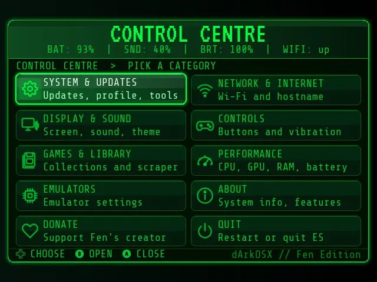
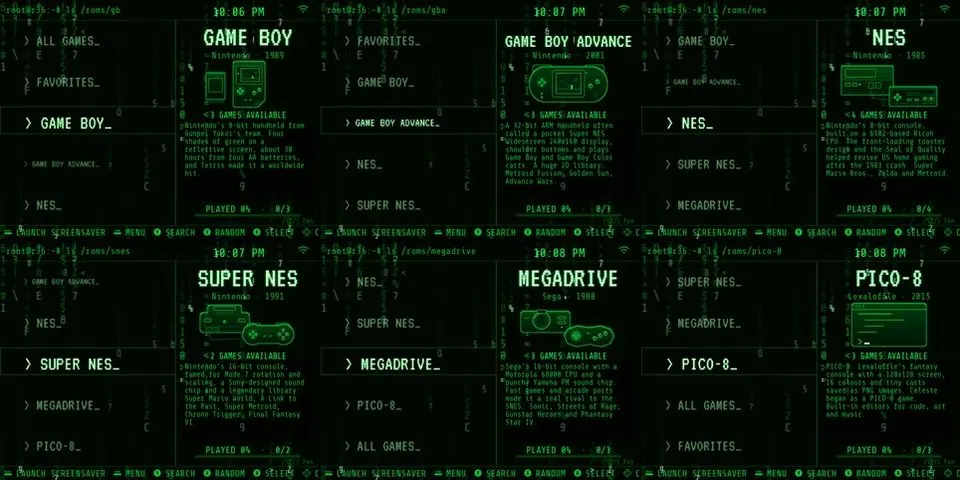

# dArkOSX — custom firmware for R36S and R36XX

[Project website](https://moorzi.github.io/darkosx-fen/) · [Release status](https://github.com/Moorzi/darkosx-fen/releases) · [Upstream dArkOS](https://github.com/christianhaitian/dArkOS)

dArkOSX is an independent Linux custom firmware build for R36S and R36XX handhelds, built **on dArkOS**. It revises EmulationStation, initial setup, lock backgrounds and frequency defaults. It is not stock dArkOS, an official upstream release, or a claim of faster emulation.

## Image availability

**Coming Soon on the project website.** An alpha release now exists, but its notes describe two `.001`/`.002` pieces while the uploaded image has seven `.part01`–`.part07` pieces. Installation guidance must be reconciled before this page recommends a download. Do not flash a partial image. Check [the release](https://github.com/Moorzi/darkosx-fen/releases/tag/v0.1.0-alpha) for updates, back up your card, confirm hardware compatibility and verify the reconstructed image checksum before installation.

## What changes

- **EmulationStation:** a terminal-style theme, tiled Control Centre and revised system panel.
- **First boot:** guided settings, confirmed with A.
- **Lock screen:** ten backgrounds selected under **Display & Sound → Lock Background**, saved across sleep and restart.
- **Frequency policy:** settings within the published hardware clock range, without overvolting.
- **File transfer:** Samba sharing and the web file browser are retained.
- **Public package:** no ROMs or copyrighted console BIOS. Supply only files you are legally entitled to use.

These describe the current build. The first release targets R36S and R36XX; the recorded device readings below are specifically from an R36S, not a separate R36XX validation.

## Interface previews

The [website gallery](https://moorzi.github.io/darkosx-fen/#look) adapts to phone and desktop screens. Its lock-background selector previews Signal Fall, Emerald Nebula, Orbital Ghost, Deep Field, Event Horizon, Circuit Noir, Aurora Drift, Vector Grid, Obsidian Signal and Ghost Wave.

## Instrument readings

Recorded on one R36S on **5 November 2026 (Europe/London)**. The battery was charging at roughly 48–53% capacity. Read-only probes sampled `/proc` and `/sys`; idle figures exclude the first sixty seconds of a 180-second sample. These are descriptive readings, not FPS benchmarks or evidence of an improvement over stock.

| Metric | Method | Result |
|---|---|---|
| Boot to multi-user | `systemd-analyze` | **15.446 s** (kernel 3.224 + userspace 12.221) |
| EmulationStation process start | seconds after boot | **11.42 s** |
| EmulationStation RSS (menu) | `/proc` VmRSS | **183 MB** |
| CPU policy | sysfs | ondemand · 1008–1512 MHz |
| Idle SoC temperature | 180 s sample | **~66 °C** median (charging) |
| Idle ES CPU share | % of one core | **~22%** median |
| System RAM | MemTotal | 895 MB |
| Stock dArkOS comparison | paired spare card | pending |

## dArkOSX vs dArkOS vs darkos

“Dark OS”, “darkos” and “dArkOS” can lead to different projects:

| Project | Purpose and relationship |
|---|---|
| [christianhaitian/dArkOS](https://github.com/christianhaitian/dArkOS) | Upstream Linux handheld firmware; use it for stock dArkOS downloads and documentation. |
| [Moorzi/darkosx-fen](https://github.com/Moorzi/darkosx-fen) | This repository: dArkOSX, an independent R36S / R36XX custom firmware build based on dArkOS. |
| [ahmad1abbadi/darkos](https://github.com/ahmad1abbadi/darkos) | A separate Wine-on-Android project, not this Linux handheld firmware. |

## Outstanding validation

- Reconcile image parts, checksums and installation guidance.
- Measure a stock-card comparison on the same handheld before publishing comparative results.
- Publish only observed performance figures, with their test conditions.

## Website

GitHub Pages serves `docs/` on `main`; `docs/.nojekyll` must remain. The page uses local fonts and responsive WebP previews, with full-size capture links. Sparse background glyphs move at 2–4 pixels per second on desktop; animation is disabled on phones and for reduced-motion preferences. Metadata, canonical URL, structured data, robots and sitemap describe this project without implying upstream affiliation. Search rankings are not guaranteed.

## Legal and credits

No games, ROMs or copyrighted console BIOS are included. Use only material you are legally entitled to use. dArkOSX is not affiliated with or endorsed by Christian Haitian, upstream dArkOS maintainers, the Android darkos project or any console manufacturer.

VT323 and Share Tech Mono are distributed under the SIL Open Font License; see `docs/assets/fonts/`.
