# dArkOSX (darkosx-fen) — dArkOS custom firmware for R36S / R36XX

<p align="center"><code>YOUR HANDHELD. REPROGRAMMED.</code></p>

<p align="center">
  
  
  
  
</p>

<p align="center">
  <a href="https://moorzi.github.io/darkosx-fen/"><b>Website</b></a>
  ·
  <a href="#what-this-is">What this is</a>
  ·
  <a href="#instrument-readings">Readings</a>
  ·
  <a href="#coming-soon">Status</a>
  ·
  <a href="https://github.com/christianhaitian/dArkOS">Upstream dArkOS</a>
</p>

<p align="center">
  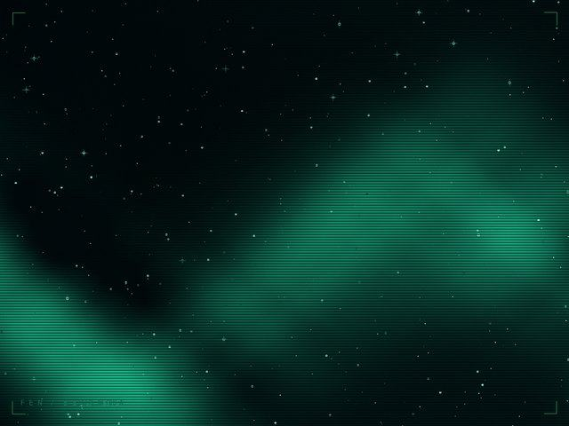
  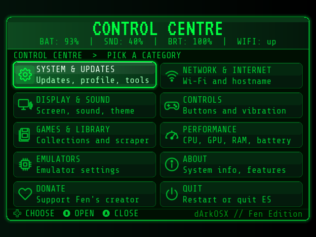
  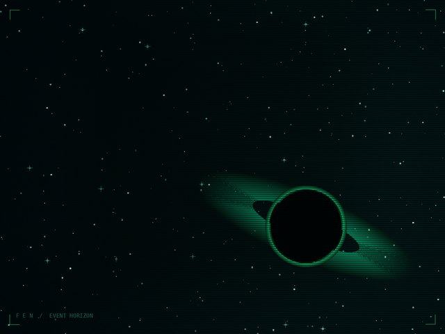
</p>

---

> [!IMPORTANT]
> **Coming soon.** The installable image is not published yet. On-device probes for this build are recorded below. A stock-card comparison will appear only after it is measured on the same handheld. Download links and install instructions will follow that work.

> [!NOTE]
> **Naming.** Searches for **dark OS**, **darkos**, or **dArkOS** usually refer to [Christian Haitian’s upstream dArkOS](https://github.com/christianhaitian/dArkOS). **dArkOSX** (this repository, `darkosx-fen`) is a **separate custom firmware** for the **R36S / R36XX** built *on* that base. It is not an official dArkOS release and does not replace upstream.

## What this is

**dArkOSX** (`darkosx-fen`) is custom firmware for the **R36S** and **R36XX** retro handhelds. It rests on [dArkOS](https://github.com/christianhaitian/dArkOS) — the community Linux handheld OS often discovered under the colloquial query “dark OS” — and keeps the network-transfer tools that community already uses.

What changes is the surface you meet every day: EmulationStation, the first-boot path, the lock screen, and the defaults that govern frequency policy. The aim is revision, not reinvention. Claims about performance wait on measurement.

If you want **stock dArkOS**, use the [upstream repository](https://github.com/christianhaitian/dArkOS). If you want this revised R36S / R36XX experience, stay here.

## What ships

| | |
|---|---|
| **Front end** | EmulationStation rebuilt with a terminal-leaning theme, a tile Control Centre, and a clearer system panel |
| **First power-on** | A short guided wizard; confirm with A and continue |
| **Lock backgrounds** | Ten original compositions (several celestial), selected under *Display & Sound → Lock Background* |
| **Measured policy** | Frequency defaults within the published clock ceiling; no overvolting |
| **Network transfer** | Samba share and web file browser retained |
| **Public package** | No ROMs and no copyrighted console BIOS |

## Lock backgrounds

<p>
  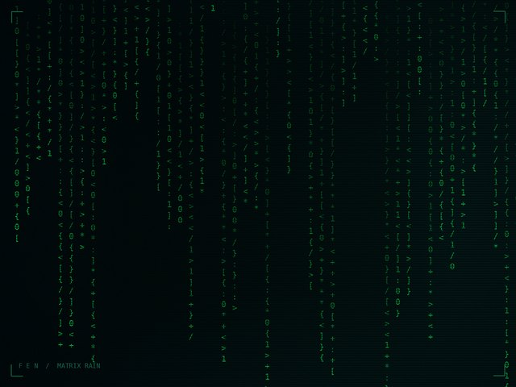
  
  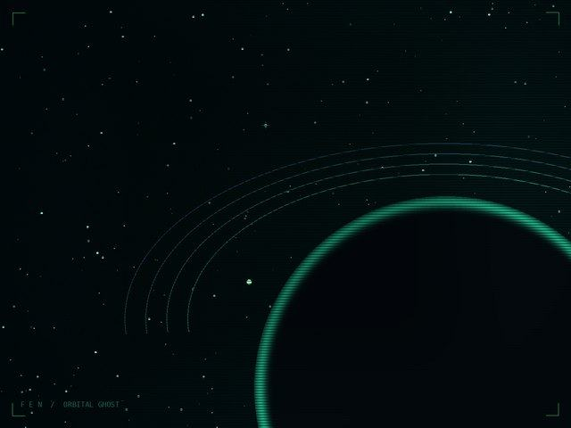
  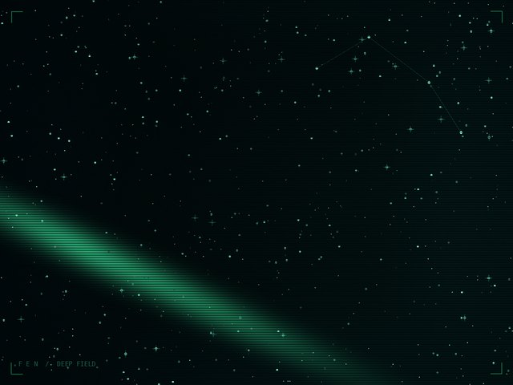
  
  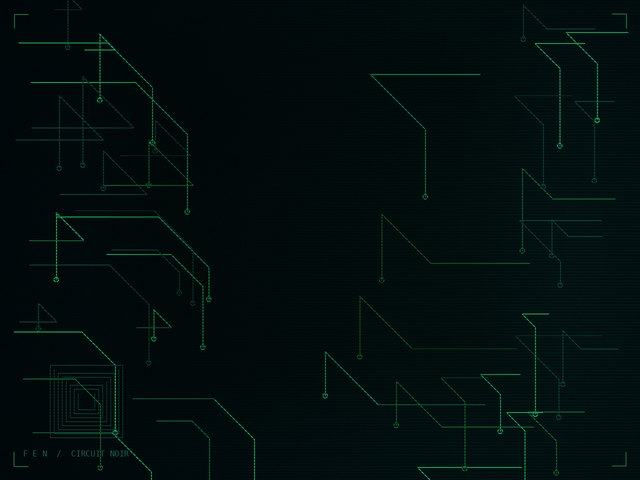
  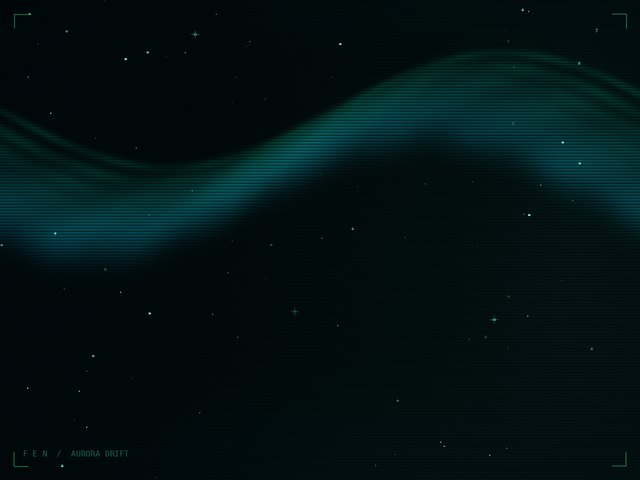
  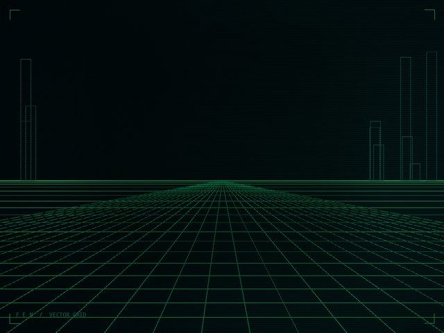
  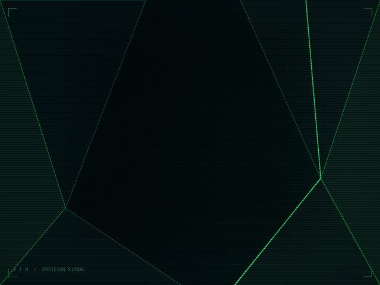
  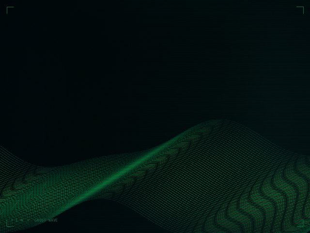
</p>

## Instrument readings

Recorded on one R36S running this build, 5 Nov 2026 (Europe/London). Battery was **charging** at about **48–53%** capacity. Probes read `/proc` and `/sys` only. Idle figures skip the first sixty seconds of a 180-second sample. **Stock dArkOS comparison is pending** (no spare stock card was available this session).

| Metric | Method | Result |
|---|---|---|
| Boot to multi-user | `systemd-analyze` | **15.446 s** (kernel 3.224 + userspace 12.221) |
| EmulationStation process start | seconds after boot | **11.42 s** |
| EmulationStation RSS (menu) | `/proc` VmRSS | **183 MB** |
| CPU policy | sysfs | ondemand · 1008–1512 MHz |
| Idle SoC temperature | 180 s sample | **~66 °C** median (charging) |
| Idle ES CPU share | % of one core | **~22%** median |
| System RAM | MemTotal | 895 MB |
| Stock dArkOS comparison | paired spare card | pending |

Summary also on the [website status section](https://moorzi.github.io/darkosx-fen/#status).

## Coming soon

```
[ OK ] firmware build ............ complete
[ OK ] first-boot path ........... ready
[ OK ] lock backgrounds .......... 10
[ OK ] network transfer .......... retained
[ .. ] stock dArkOS card pair .... pending
[ .. ] public image .............. coming soon
```

- **Download:** added with the first public image
- **Install guide:** published with the download
- **Checksums:** beside every release artefact
- **Hardware:** R36S / R36XX for the first release

## Related projects

| Project | Role |
|---|---|
| [christianhaitian/dArkOS](https://github.com/christianhaitian/dArkOS) | Upstream handheld OS (dArkOS / “dark OS”) |
| [Moorzi/darkosx-fen](https://github.com/Moorzi/darkosx-fen) | This custom firmware (dArkOSX) for R36S / R36XX |
| [moorzi.github.io/darkosx-fen](https://moorzi.github.io/darkosx-fen/) | Project site |

## Legal

**No games, ROMs, or copyrighted BIOS files are included, and none will be.** Use only dumps taken from hardware you own. Requests for ROMs or BIOS files will be closed.

dArkOSX is an unofficial community build atop [dArkOS](https://github.com/christianhaitian/dArkOS). It is not affiliated with or endorsed by Christian Haitian, dArkOS maintainers, or any console manufacturer. Site fonts: VT323 and Share Tech Mono (SIL Open Font License; see `docs/assets/fonts/`).
